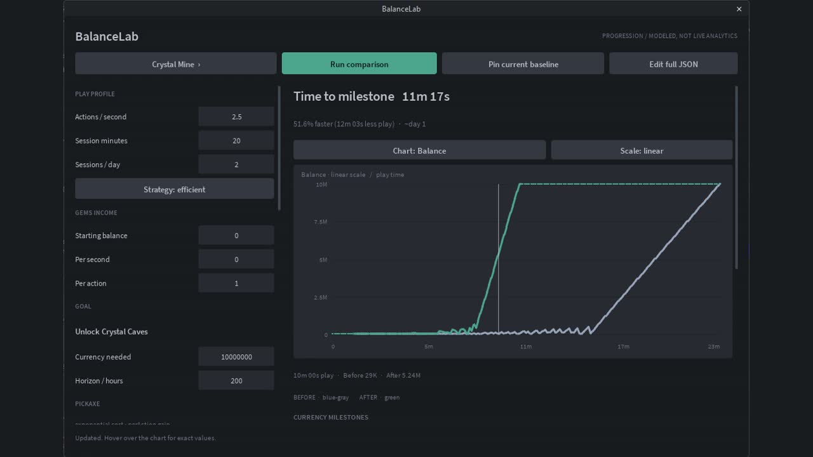

# BalanceLab

Model a Roblox progression loop, change an assumption, and see what happens to the wait.



[Watch the Studio demo](https://github.com/Ggaming5005/BalanceLab/releases/download/v0.1.0/BalanceLab-demo.mp4).

BalanceLab is a small Luau simulation library and native Studio plugin. It follows one currency through earning, upgrades and a milestone, or through repeated rolls toward a loot target. Pin a baseline, edit the config, and compare the resulting timeline.

## Install

Download the assets from [Releases](https://github.com/Ggaming5005/BalanceLab/releases):

| File | Use |
| --- | --- |
| `BalanceLabStudio.rbxm` | Studio plugin |
| `BalanceLab.rbxm` | Independent runtime ModuleScript |
| `BalanceLab-demo.mp4` | Short demonstration |

Insert the plugin asset into a temporary place, select its root Script, and choose **Save as Local Plugin**. Delete the inserted copy. Open **Plugins → BalanceLab**.

For the library examples below, insert `BalanceLab.rbxm` into `ReplicatedStorage` and name the ModuleScript `BalanceLab`. The plugin contains its own copy and does not require this runtime installation.

Choose Crystal Mine, Factory Tycoon or Pet Hatchery. The first run becomes the baseline. Edit a field, click **Run comparison**, then inspect the chart. **Pin current baseline** establishes the next comparison. Switching presets starts a fresh comparison.

The plugin renders inside a resizable Studio widget. Its parameters and results scroll independently. Currency charts show balance or earning rate; loot charts show target ownership probability or earning rate. Lines are sampled for display; hover values and milestones use the event timeline.

## Configs

Use the quick fields for play rate, income, goals and upgrade numbers. **Edit full JSON** also lets you add/remove upgrades, change curve types and edit loot entries. The editor validates before applying changes and never executes JSON as code.

**Export ModuleScript** creates `ReplicatedStorage.BalanceLabConfig` with an undoable Studio change. **Import selected module** runs the selected ModuleScript and validates its returned table. Import a self-contained config you trust; the import action executes code, including any side effects in that module. A fresh source copy avoids returning a cached config after edits. Module children are not copied.

```luau
local BalanceLab = require(game.ReplicatedStorage.BalanceLab)
local config = require(game.ReplicatedStorage.BalanceLabConfig)
local result = BalanceLab.simulate(config)

print(result.status, BalanceLab.Format.duration(result.goalTime))
print(BalanceLab.costOf(result.config, "pickaxe", 3))
```

A minimal raw config:

```luau
return {
	name = "First cave",
	income = { perAction = 1 },
	player = { actionsPerSecond = 2, sessionMinutes = 20, sessionsPerDay = 2 },
	upgrades = {
		{
			id = "pickaxe",
			effect = { kind = "perAction", curve = "linear", base = 1, growth = 0 },
			cost = { curve = "exponential", base = 25, growth = 1.16 },
			maxLevel = 50,
		},
	},
	goal = { kind = "currency", name = "Unlock cave", amount = 100000 },
}
```

`validate(raw)` returns a deeply frozen normalized config and an empty problem list, or `nil` and problems containing `path` and `message`. `Config.draft(config)` returns a mutable copy. `toSource(config)` serializes a validated config as a returning ModuleScript. The config format is version 1.

## Model

- Play time earns `perSecond + perAction × actionsPerSecond`, multiplied by the accumulated multiplier.
- Each bought level **adds** its curve value. Multiplier bonuses also add to the starting multiplier of 1; two bonuses of 0.15 produce 1.3×.
- Curves are zero-indexed: exponential is `base × growth^owned`; linear is `base + growth × owned`; power is `base × (owned + 1)^growth`.
- `efficient` chooses the shortest payback among upgrades that improve its current goal estimate. This is a greedy heuristic, not a globally optimal planner. `eager` favors the cheapest useful upgrade costing no more than a goal step.
- A currency goal is the first time the wallet holds the requested amount. Purchases and rolls are instantaneous. No offline income, player drop-off, trading or reward income from loot is modeled.
- Session settings convert play time into an approximate calendar day using average daily activity. They do not simulate session boundaries or offline earnings.

For loot, weights define a fixed independent target chance. Hard pity `N` guarantees the target on roll `N` if earlier rolls missed; `0` disables pity. The simulator schedules purchases for the players still missing the target. Its first-success distribution gives the median, 90th and 99th percentile play times exactly under those assumptions. These are modeled probabilities, not empirical player analytics. Soft pity, changing luck and multi-item collection goals are outside this release.

## API and limits

`simulate(raw, options?)` returns the config, timeline, goal time, income, balance, spending, upgrade levels, longest wait and optional loot results. Loot `goalTime` is the median. `status` is `reached`, `horizon`, `stalled`, `limit` or `cancelled`; a missing percentile time means the schedule did not reach it. A loot run can reach its median while its upper-tail schedule ends at a limit. Inspect both the times and status.

Long runs can yield and cancel:

```luau
local result = BalanceLab.simulate(config, {
	yieldEvery = 500,
	yield = task.wait,
	isCancelled = function() return cancelled end,
})
```

| Function | Result |
| --- | --- |
| `compare(before, after)` | Time difference, ratio and concise description |
| `costOf(config, id, owned)` | Next level price; `nil` at maximum level |
| `effectOf(config, id, owned)` | Sum of the owned levels' effects |
| `Simulate.balanceAt(result, seconds)` | Held currency, or `nil` outside the run |
| `Simulate.incomeAt(result, seconds)` | Income at that moment |
| `Simulate.chanceAt(result, seconds)` | First-target chance by that moment |
| `Simulate.timeAtBalance(result, amount)` | First held-currency milestone |
| `Loot.rollsFor(p, pity, q)` | Smallest roll count reaching `0 < q < 1` |
| `Loot.expected(p, pity)` | Expected rolls until first success |

The library accepts at most 12 upgrade types, 1,000 levels each and 50 loot entries. Input amounts and generated per-level values must be at most `1e30`; minimum target chance is `1e-9`. Runs stop at 50,000 rolls, 100,000 events or the configured play-time horizon. Numeric calculations use ordinary double precision. See [Config.luau](src/BalanceLab/Config.luau) for all bounds.

There are no package dependencies, HTTP calls, asset IDs or persistent storage. The game only needs the runtime if you want its helpers; the plugin is a separate asset.

## Development

Luau 0.747 and Rojo 7.7.0:

```sh
luau tests/run.luau
luau examples/Compare.luau
luau-analyze src/BalanceLab/*.luau tests/*.luau
rojo build default.project.json -o dist/BalanceLab.rbxm
rojo build plugin.project.json -o dist/BalanceLabStudio.rbxm
```

For plugin testing, `App.start(plugin)` returns `Widget`, `State`, `Chart`, `Controls`, `Run`, `LoadPreset`, `SetConfig`, `SetValue`, `PinBaseline`, `Export` and idempotent `Destroy`. The repeatable comparison in [StudioDemo.luau](examples/StudioDemo.luau) lowers Crystal Mine's pickaxe cost growth from 1.16 to 1.13. [Compare.luau](examples/Compare.luau) runs the same comparison outside Studio.

Read the [research and design notes](docs/research.md) and [verification record](docs/verification.md). Original MIT source by [Ggaming5005](https://github.com/Ggaming5005).
